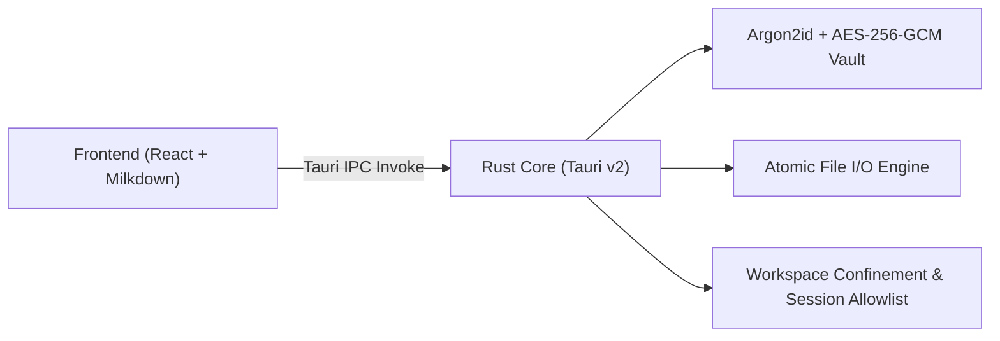

# Markseal

Markseal is a hardened, local-first markdown note editor and encrypted personal vault built with **Tauri v2**, **React 19**, **TypeScript**, and **Milkdown Crepe**.

---

## Features

- **WYSIWYG Markdown Editing**: Smooth, modern editing experience powered by Milkdown Crepe (ProseMirror engine) with support for tables, lists, code blocks, task items, and live previews.
- **Zero-Knowledge Encrypted Vault**: Encrypt sensitive notes into self-contained `.enc` files using authenticated AES-256-GCM encryption with Argon2id key derivation.
- **Workspace Navigation & Search**: Fast tree-based workspace explorer with full-text search across all markdown files within the active folder.
- **Direct Image Pasting**: Paste images directly from the clipboard. Images are automatically saved into `<note_dir>/assets/img_<timestamp>.<ext>` and referenced relatively.
- **Safe HTML Export**: Export notes to standalone HTML documents with styled layout and automatic sanitization of script tags and malicious attributes.
- **Dynamic Theming**: Seamless switching between Light, Dark, Nord, and Solarized themes without re-initializing the editor or losing cursor position / undo history.
- **Privacy & Offline First**: Zero cloud dependencies, zero telemetry, zero background network calls.

---

## Architecture

Markseal uses a modular architecture dividing user interface from systems-level I/O:

- **Frontend**: React 19, TypeScript, Vite, Milkdown Crepe, Lucide React icons, and tailored CSS variables.
- **Backend (Rust / Tauri v2)**: Native window management, secure filesystem operations, cryptographic primitives, and asset protocol handling.
- **IPC Protocol**: All communication between frontend and backend passes through strongly typed, validated Tauri invoke commands.



---

## Security Model & Hardening

Markseal is designed with defense-in-depth security principles:

### 1. Cryptographic Specifications
- **Cipher**: AES-256-GCM (Galois/Counter Mode) providing authenticated encryption and tamper detection.
- **Key Derivation**: Argon2id (`v=0x13`, 64 MiB memory cost, 3 iterations, 4 parallelism lanes).
- **Salt & Nonce**: Cryptographically secure random 16-byte salt and 12-byte nonce per encrypted file (`rand::rngs::OsRng`).
- **Memory Hygiene**: Passwords and decrypted plaintext buffers are managed using `zeroize::Zeroizing` to guarantee that memory is wiped when dropped.

### 2. Strict Workspace Confinement & Session Allowlist
- **Confinement**: Path canonicalization resolves all symlinks and verifies that target files reside strictly within the active workspace root.
- **Traversal Prevention**: Relative parent segments (`..`) and null bytes (`\0`) are rejected unconditionally.
- **Session Allowlist**: When opening or saving a file outside the workspace via native system dialogs ("Save As" or "Export HTML"), the canonical path is recorded in a temporary in-memory session allowlist.
- **Strict Deletion Boundary**: Destructive deletion operations (`delete_note_file`) enforce strict workspace confinement and deliberately ignore the session allowlist; files outside the active workspace cannot be deleted through Markseal.

### 3. Atomic File Writes
- All note saves, encrypted exports, and pasted assets are written via a temporary sibling file (`.<filename>.<timestamp>.tmp`) with synchronous flushing to disk (`sync_all()`) before an atomic rename, preventing data corruption during unexpected power cuts or crashes.

### 4. Denial-of-Service Defense
- File operations (reading, saving, searching, and pasting assets) enforce a strict **25 MiB cap** (`25 * 1024 * 1024` bytes) to prevent memory exhaustion and denial-of-service vulnerabilities.

### 5. SSD / CoW Deletion Caveat
- The note deletion feature performs a single-pass zero overwrite before unlinking on a best-effort basis.
- **Important limitation**: On wear-leveled flash media (SSDs, NVMe drives) or copy-on-write filesystems (NTFS Volume Shadow Copies, APFS, Btrfs, ZFS), physical blocks may persist in storage controller wear-leveling translation layers until overwritten or cleared by TRIM/garbage collection. For complete forensic data eradication, full-disk encryption (e.g., BitLocker, FileVault, LUKS) is recommended.

### 6. Production Content Security Policy (CSP)
- Markseal enforces a strict Content Security Policy in production builds:
  ```text
  default-src 'self';
  img-src 'self' asset: http://asset.localhost https://asset.localhost data: blob:;
  style-src 'self' 'unsafe-inline';
  font-src 'self' data:;
  script-src 'self';
  connect-src 'self' ipc: http://ipc.localhost
  ```
- Unsafe evaluation (`'unsafe-eval'`) and external network connections are prohibited.

---

## Getting Started

### Prerequisites
- [Node.js](https://nodejs.org/) (v18 or later recommended)
- [Rust](https://www.rust-lang.org/) (1.78+ recommended)
- Windows C++ Build Tools (or equivalent platform build essentials)

### Development
Install dependencies:
```bash
npm install
```

Start the application in development mode:
```bash
npm run tauri dev
```

### Running Tests
Execute the backend security and integration test suite:
```bash
cargo test --manifest-path src-tauri/Cargo.toml
```

### Production Build
Build the optimized production binary and installer:
```bash
npm run build
npm run tauri build
```

---

## License

Markseal is licensed under the [MIT License](LICENSE).
Copyright (c) 2026 Markseal Contributors.
